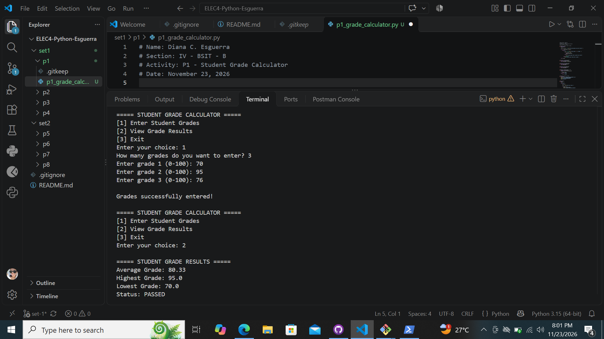
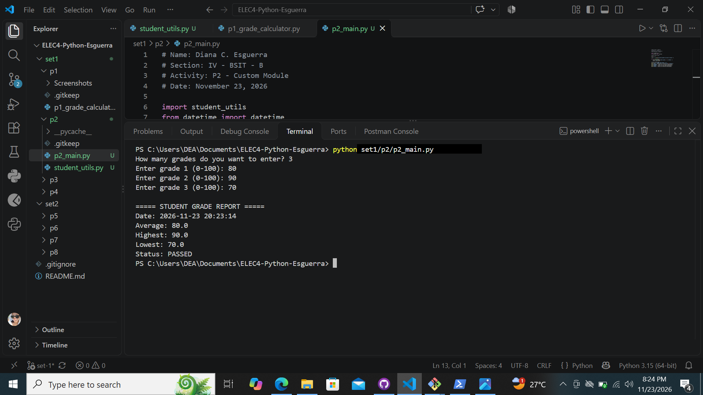
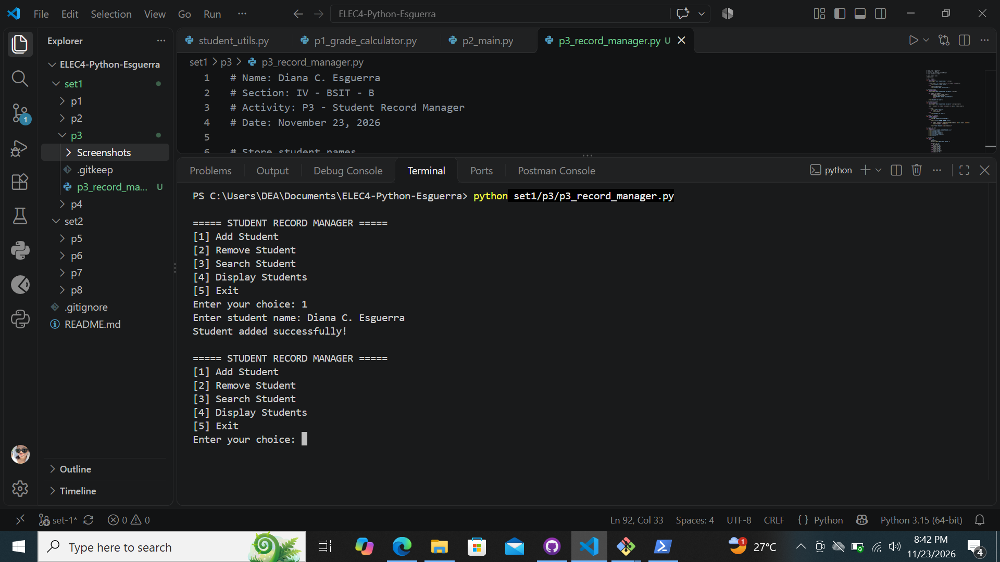

# ELEC4 - Python Activities

**Student Name:** Diana C. Esguerra  
**Section:** IV - BSIT - B  
**Course:** ELEC4 - Python Programming

## Set 1 Activities

| Activity | Description | Folder | Run Command |
|---|---|---|---|
| P1 - Student Grade Calculator | Uses functions to calculate student grades. | [P1](set1/p1/) | `python set1/p1/p1_grade_calculator.py` |
| P2 - Custom Module | Uses a custom module to process student grades. | [P2](set1/p2/) | `python set1/p2/p2_main.py` |
| P3 - Student Record Manager | Uses lists to manage student records. | [P3](set1/p3/) | `python set1/p3/p3_record_manager.py` |
| P4 - Exception Handling | Handles errors using try and except. | [P4](set1/p4/) | `python set1/p4/p4_exception_handling.py` |

## Set 1 Screenshots

### P1 - Student Grade Calculator

### P2 - Custom Module

### P3 - Student Record Manager

### P4 - Exception Handling

## Set 2 Activities

- P5 - File I/O
- P6 - Recursion
- P7 - Classes and Objects
- P8 - Inheritance and Polymorphism

*Set 2 details, run commands, and screenshots will be added after completing the activities.*